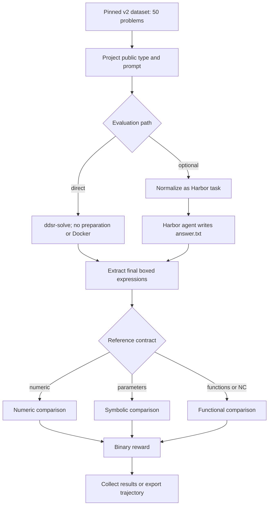

# CMT-Benchmark pipeline

CMT-Benchmark is a text-scoring benchmark. Direct static evaluation is
preferred; optional Harbor normalization provides the same task and artifact
boundaries as the other supported benchmarks.

One trial is one problem-attempt pair. Concurrency schedules independent trials
without changing attempt grouping. Multiple answers are separated by semicolons
inside one final box. Missing boxes, malformed expressions, worker errors, and
timeouts receive zero; no repair prompt is sent.

Pass rate uses all scored problems as its denominator. Parse rate counts trials
whose expressions were evaluated successfully, whether equivalent or different.
