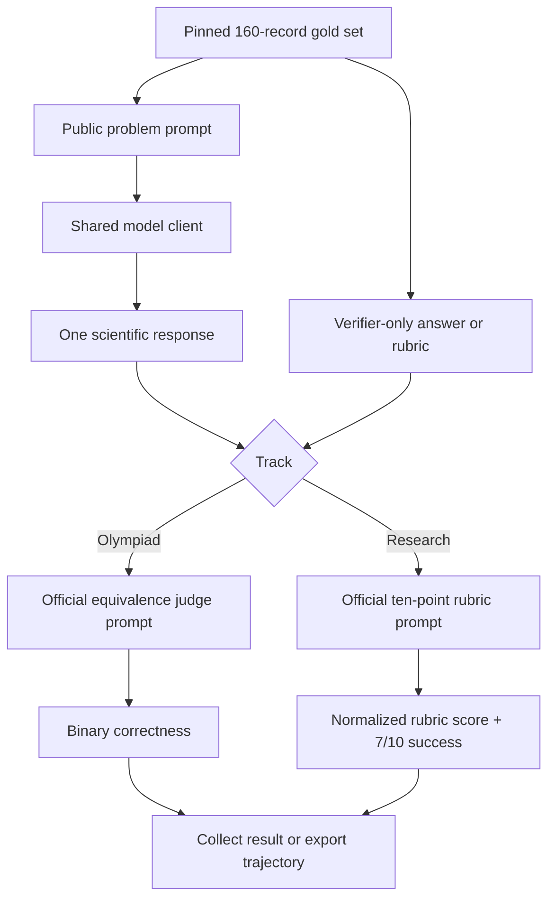

# FrontierScience pipeline

One trial is one problem-attempt pair followed by one judge request. Empty model
answers score zero without invoking the judge. A judge transport or parse failure
is recorded as unjudged rather than silently repaired. Separate trial directories
prevent concurrent attempts from overwriting one another.
