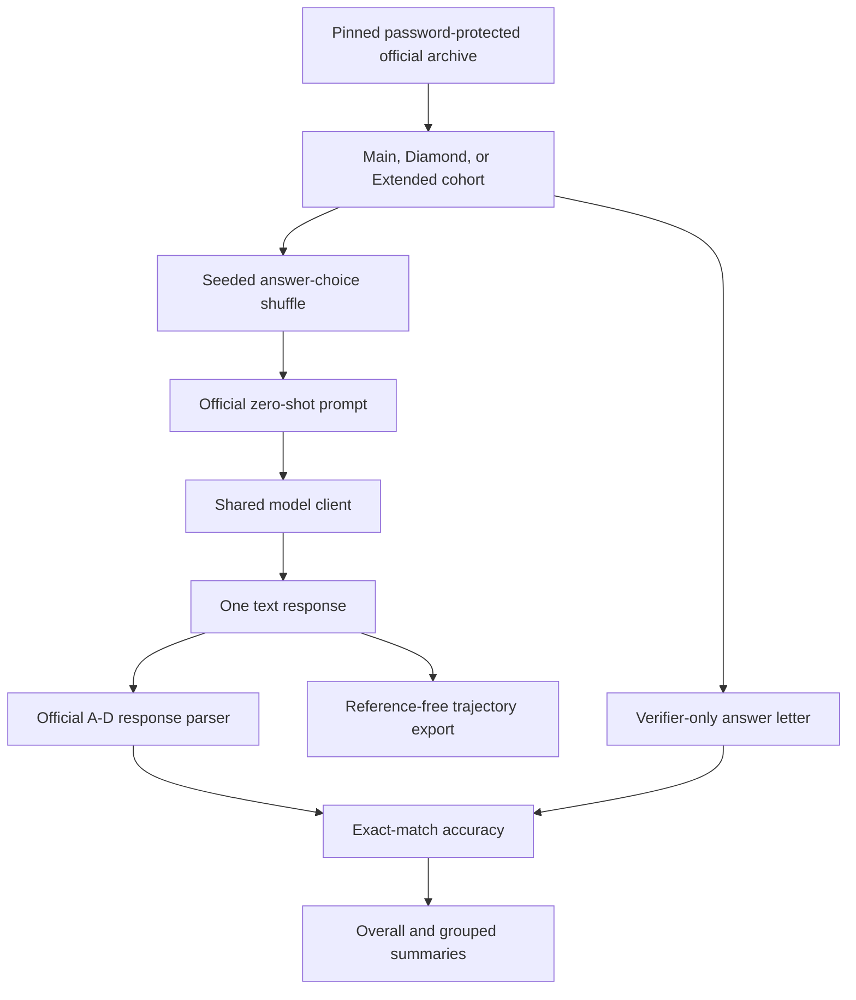

# GPQA pipeline

One trial is one question-attempt pair with an independent output directory.
The verifier parses a single A-D choice from the response and assigns zero to
malformed output. It does not use the released expert explanation for scoring.

Static evaluation is protocol-complete because GPQA requires no code execution
or environment state. Prepared tasks provide an offline copy of the default
Main cohort; named alternate cohorts are loaded from the pinned raw archive.
