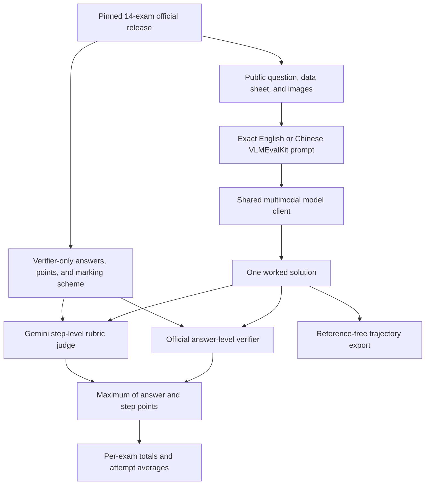

# HiPhO pipeline

One trial is one subquestion-attempt pair with an independent directory. The
published protocol uses eight attempts, averages each subquestion across those
attempts, sums within each exam, and reports the mean of 13 exam totals. DDSR
also exposes the 14-exam current release and always labels the chosen cohort.

The scorer runs on the host because it parses text and calls a judge; it never
executes model-generated code. Prepared tasks provide the common offline data
layout and Hugging Face fallback, not a reason to invoke Harbor.
