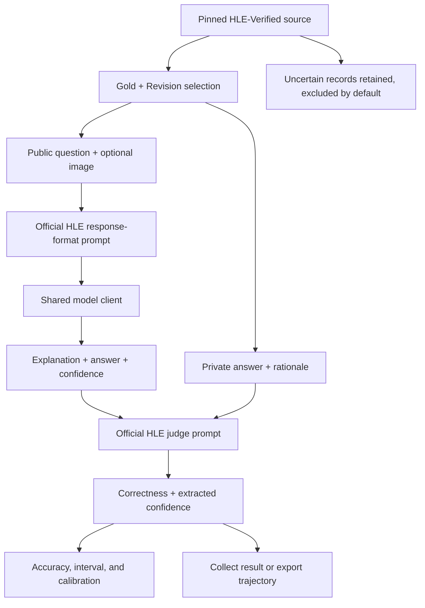

# HLE pipeline

HLE is a multimodal response benchmark with host-side LLM judging. Prepared
tasks provide the shared offline data boundary; they are not Harbor execution
environments.

One trial is one problem-attempt pair and makes one generation request followed
by one judge request. The shared client reproduces the upstream single transport
retry; malformed judge output receives zero rather than a hidden repair call.
Empty model responses are still judged, matching the official harness. Failed
generation or judging remains explicit in the saved result.

Five attempts reproduce HLE-Verified's avg5 evaluation protocol. Attempts use
independent provider calls and separate trial directories. Correct answers enter
only prepared verifier data and the judge request; rationales remain verifier
data. Neither enters model-under-test messages, generation logs, or teacher
trajectories.
