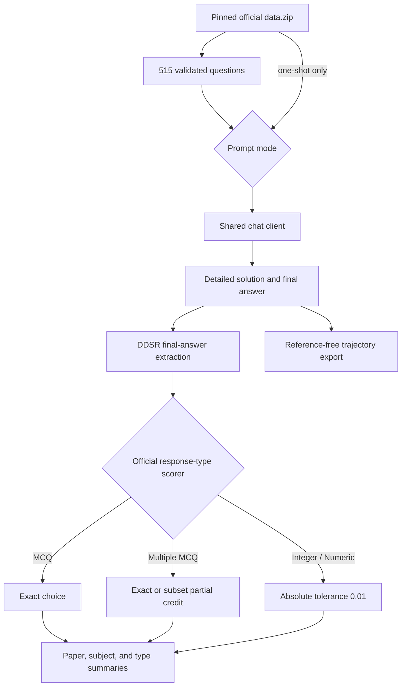

# JEEBench pipeline

Static evaluation is complete because model text is parsed but never executed.
One trial is one question and one attempt; multiple attempts can reproduce
self-consistency sampling without changing the benchmark scorer.
