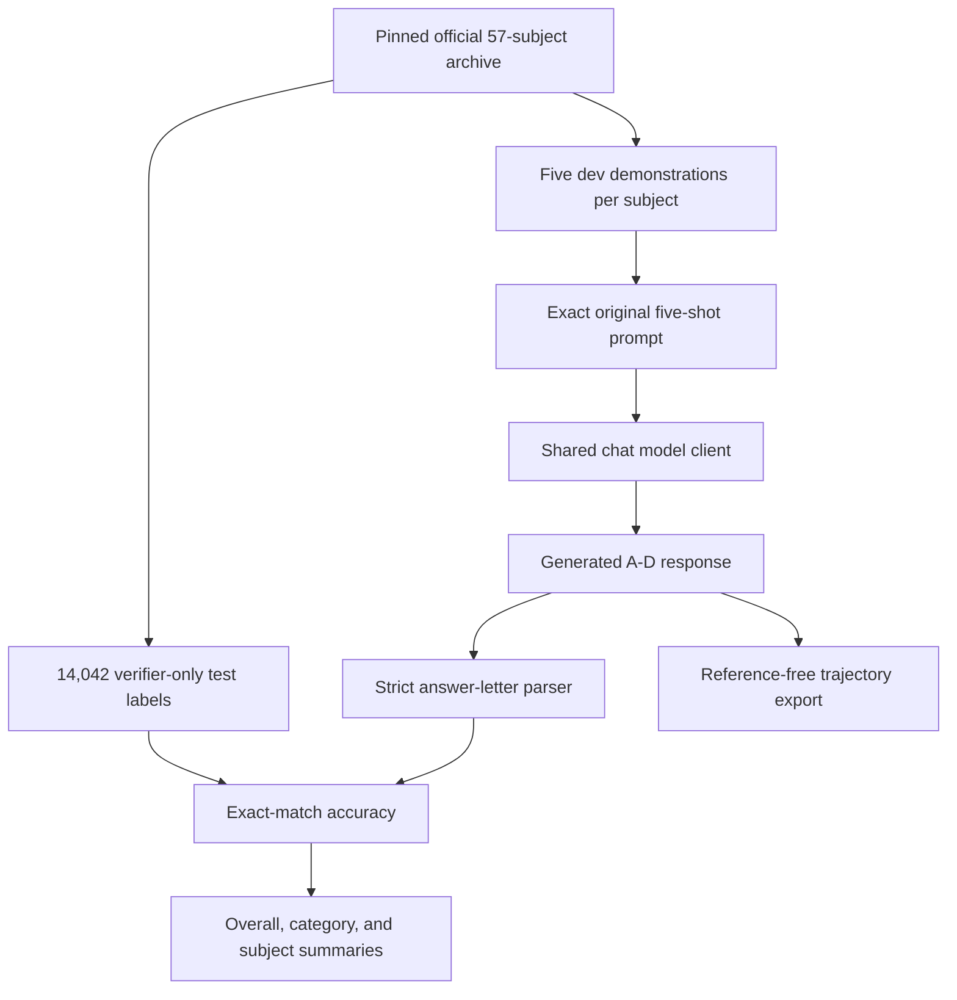

# MMLU pipeline

One trial is one test-question attempt. DDSR preserves the original prompt but
uses generated answer letters instead of legacy completion-token likelihoods;
the recorded `mmlu-generative` mode makes this protocol distinction explicit.
Static evaluation is complete for this path, and Harbor adds no isolation value.
