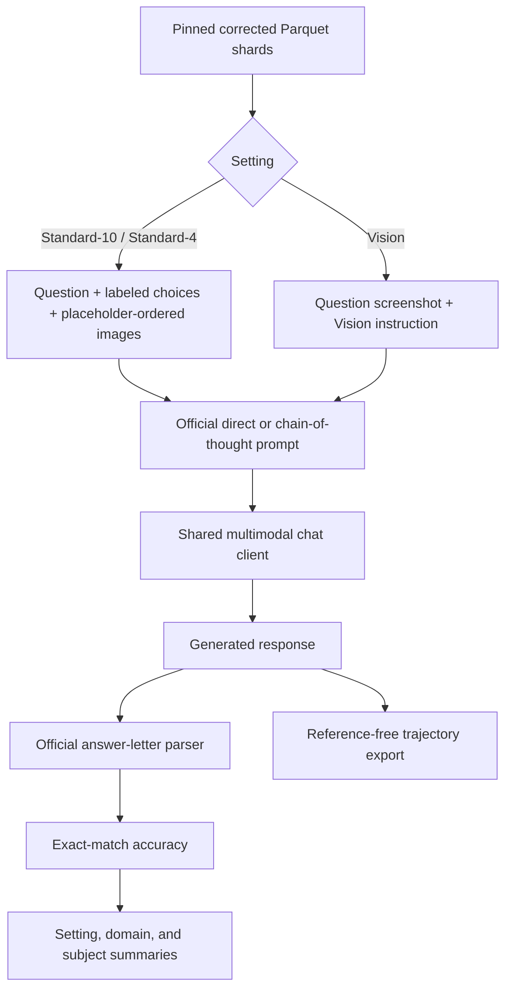

# MMMU-Pro pipeline

One trial is one setting-specific question attempt. The official headline is
the arithmetic mean of complete Standard-10 and Vision accuracies. Standard-4
is reported separately. Static evaluation fully implements the released
multiple-choice verifier.
