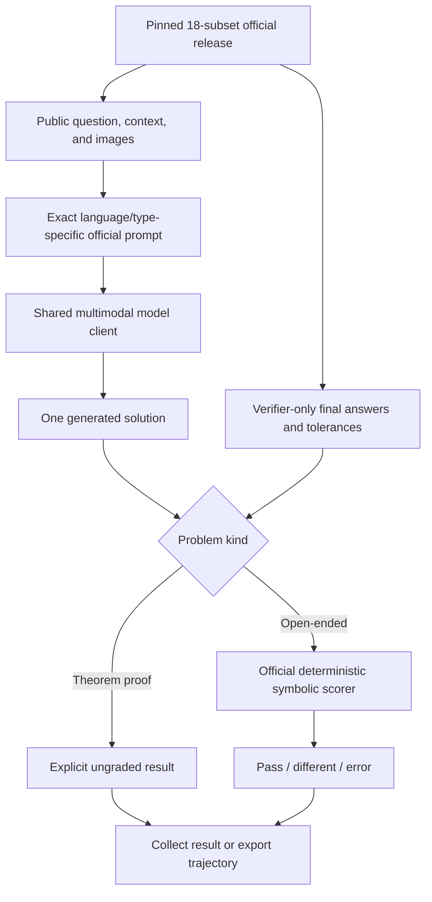

# OlympiadBench pipeline

One trial is one problem-attempt pair in its own directory. Static evaluation is
the primary path because no generated program is executed. Open-ended scoring is
bounded by the job runner and uses no network. Proof responses remain available
for later human or explicitly configured judge analysis, but do not enter the
official automatic accuracy denominator.
