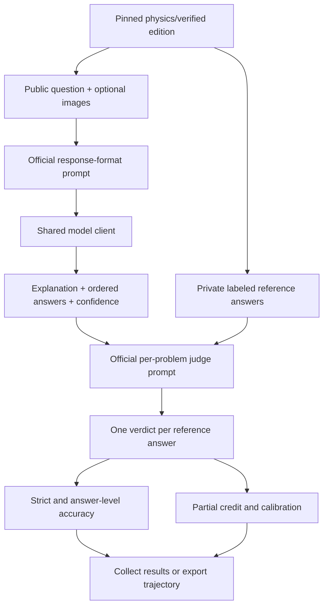

# PHYSICS pipeline

PHYSICS is a multimodal text benchmark with host-side LLM judging. Prepared
tasks provide a common offline data boundary; they are not Harbor execution
environments.

One trial is one problem-attempt pair and makes one generation request followed
by at most one successful judge request. Malformed judge output is retried up
to the configured official limit. An empty final response is marked wrong
without a judge call. Failed generation or exhausted judge retries receive zero
while remaining distinguishable in the saved result.

The model is not told how many answers are expected. The judge receives every
labeled reference for that problem and returns answer-level verdicts plus one
confidence value. References never enter model messages, generation logs, or
teacher trajectories.
