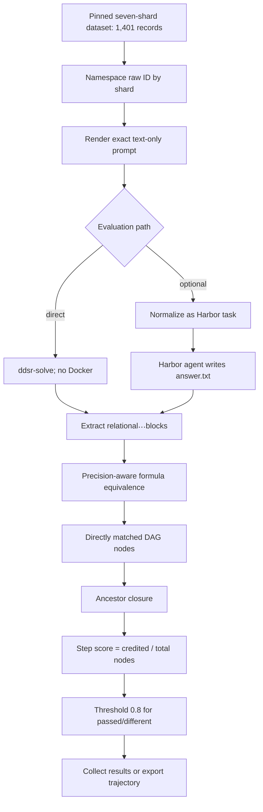

# PRISM-Physics pipeline

PRISM-Physics is a static formula-scoring benchmark. Direct evaluation is
preferred; optional Harbor normalization preserves the same request, artifact,
and verifier boundaries.

One trial is one problem-attempt pair. Formula matches are independent: one
student formula may match more than one reference node. Every directly matched
node credits all transitive prerequisites, and the union is divided by the
number of reference formulas. Empty DAGs or responses without relational
double-dollar blocks score zero. Worker exceptions and timeouts also receive
zero; no repair or judge prompt is sent.

Harbor stores public input in `instruction.md`, the private formula DAG in
`tests/reference.json`, and generation in `answer.txt`. The verifier container
has no network. Direct static runs create the analogous `agent/`, `artifacts/`,
and `validation/` directories per trial, so concurrent attempts never share
writable files.
