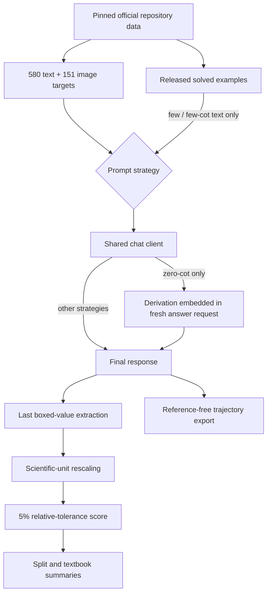

# SciBench pipeline

One trial is one target/strategy attempt. Image targets are official released
data, but their chat-message envelope is a documented DDSR choice because the
pinned repository publishes no multimodal inference script.
